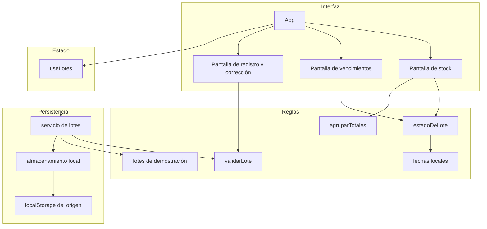

# Documento de diseño

## Overview

Esta etapa de Manos a la Obra permite a cualquier voluntario registrar donaciones, consultar el stock y distinguir lotes en buen estado, próximos a vencer y vencidos. No hay cuentas, familias, entregas ni distribución.

La aplicación es una SPA en JavaScript con React, Vite y Tailwind CSS. El navegador es la única fuente de datos: cada lote se guarda en `localStorage` y vuelve a aparecer al recargar. Otro navegador u otro dispositivo no comparte esa información.

El estado de vencimiento no se guarda. Se calcula cada vez que se muestra un lote, comparando su fecha de vencimiento con el día local. Así, un lote próximo a vencer pasa a vencido al día siguiente sin que nadie lo edite.

### Decisiones

- Cada donación es un lote. Dos ingresos de arroz con distinto vencimiento no se fusionan.
- La vista activa vive en el estado de React, sin router. Con tres pantallas no hace falta una dependencia de rutas ni reglas de redirección. Al recargar, los datos siguen guardados y la pantalla que se abre es Stock.
- La semilla de demostración se genera con fechas relativas al día en que la aplicación arranca por primera vez, y solo si la clave de almacenamiento no existe. Un arreglo vacío es un stock vacío real: no se vuelve a sembrar.
- Las fechas se guardan como `YYYY-MM-DD` y se comparan como texto. No se usa `Date.prototype.toISOString()` ni `new Date("YYYY-MM-DD")`, porque ambos trabajan en UTC y pueden correr el día respecto del calendario local.
- La ventana de «próximo a vencer» es una constante de 7 días, incluida la fecha de hoy.
- La cantidad en unidades debe ser un entero. Kilogramos y litros aceptan decimales, con un máximo de tres cifras decimales.
- El nombre se recorta y se conserva tal como lo escribió el voluntario. Los totales agrupan por nombre exacto y unidad, así que «Arroz» y «arroz» no se suman.
- El nombre admite hasta 80 caracteres. El requisito no fija un tope; el límite evita textos que rompan la tabla.
- Si la lectura del almacenamiento falla, la aplicación no lo repara sola. Un guardado posterior, hecho por el voluntario, reemplaza el valor ilegible.

Si alguna de estas reglas no coincide con lo esperado, se puede volver a los requisitos antes de armar el plan.

## Architecture



React dibuja la interfaz y conserva en memoria la lista de lotes ya leída. Las pantallas no hablan con `localStorage`. El hook `useLotes` pide las operaciones al servicio, y el servicio es el único que decide cuándo sembrar datos, validar y escribir.

El almacenamiento local solo lee y escribe una cadena JSON bajo una clave fija. Traduce los fallos del navegador a errores de la aplicación.

Vite genera el sitio estático. Tailwind, mediante el plugin oficial de Vite, produce el CSS de la interfaz. No hay backend, base de datos ni autenticación.

La build de producción es el directorio `dist`. Como la navegación no cambia la URL, no hace falta una regla para reenviar rutas al `index.html`.

### Arranque

1. La aplicación pide los lotes guardados.
2. Si la clave no existe, el servicio crea la semilla, intenta guardarla y muestra esos lotes.
3. Si la clave existe, muestra ese valor, aunque sea una lista vacía.
4. Si la lectura falla, muestra la lista vacía y un aviso. No escribe la semilla.
5. Cada alta, corrección o baja válida se escribe primero. La pantalla cambia solo después de un guardado correcto.

## Components and Interfaces

El código queda en `src/` con las carpetas ya definidas para el proyecto: `components/`, `pages/`, `hooks/`, `services/`, `utils/`, `data/` y `assets/`.

### Pantallas

| Pantalla | Responsabilidad | Requisitos |
| --- | --- | --- |
| Stock | Lista cada lote ordenado por vencimiento y muestra el total por alimento y unidad. Ofrece corregir, eliminar y pasar al registro. | 2.1, 2.2, 2.3, 2.4, 2.5, 3.6, 3.7, 4.3 |
| Vencimientos | Dos grupos: próximos a vencer y vencidos. Cada grupo tiene su propio vacío. | 3.4, 3.5, 3.6, 3.7 |
| Registro y corrección | Un mismo formulario. En alta, la fecha de recepción puede quedar vacía. En corrección, muestra los datos del lote, incluida la fecha de recepción. | 1.1, 1.2, 1.3, 1.4, 1.5, 1.6, 4.1, 4.2 |

La pantalla de stock usa una tabla en computadora y en tablet horizontal. En un ancho más estrecho, cada lote pasa a una ficha con los mismos datos y las mismas acciones. La información importante no queda escondida en columnas ilegibles.

### Componentes

- `Marca`. Ícono de una mano que sostiene un corazón, el título «Manos a la Obra» y el subtítulo «banco de alimentos comunitario» en versalitas. El ícono es un SVG simple, también usado como favicon. No se usan emojis.
- `Navegacion`. Tres destinos con texto: Stock, Vencimientos y Registrar. El destino activo se distingue por color y por el estado del control, no solo por un ícono.
- `FormularioDonacion`. Etiquetas sobre los campos, campos obligatorios marcados y el mensaje de cada dato inválido junto a ese campo. Campos: nombre, cantidad, unidad, fecha de vencimiento y fecha de recepción.
- `ResumenStock`. Totales agrupados por nombre y unidad.
- `ListadoLotes`. Tabla o fichas. Incluye la etiqueta de estado.
- `EtiquetaEstado`. Texto «En buen estado», «Próximo a vencer» o «Vencido», con un color de apoyo. El color nunca viaja solo.
- `EstadoVacio`. Mensaje en español. En stock explica que todavía no hay alimentos y lleva al registro. En cada grupo de vencimientos dice que no hay lotes en esa situación.
- `DialogoConfirmar`. Pregunta antes de eliminar. Confirmar ejecuta el borrado. Cancelar cierra el diálogo y no toca el lote.
- `AvisoError`. Mensaje de lectura o de escritura fallida.
- `Boton`. Variantes principal (verde hoja), secundaria (superficie clara con borde verde), acento (naranja, de uso puntual) y destructiva (rojo).

### Identidad visual

Los tokens siguen la skill de marca:

| Token | Uso | Color |
| --- | --- | --- |
| Fondo general | Superficie de la página | `#F3E6A3` |
| Superficie | Tarjetas, formulario, tabla y diálogos | `#FFFDF7` |
| Hoja | Navegación, sección activa y acción principal | `#527A3B` |
| Texto | Títulos y texto principal | `#30452F` |
| Texto secundario | Ayudas y descripciones | `#59645A` |
| Zanahoria | Acento puntual, no como fondo extenso | `#E97836` |
| Cielo | Avisos informativos | `#8CCBDD` |

Los estados del alimento usan colores distintos de la paleta de marca:

| Estado | Presentación |
| --- | --- |
| En buen estado | Verde y la etiqueta «En buen estado» |
| Próximo a vencer | Ámbar y la etiqueta «Próximo a vencer» |
| Vencido | Rojo oscuro y la etiqueta «Vencido» |

La tipografía es Nunito Sans. El subtítulo de la marca es el único texto en versalitas. Los botones tienen área cómoda, foco visible y etiquetas legibles. No hay degradados, animaciones decorativas ni paneles cargados de indicadores.

### Hook

`useLotes()` devuelve:

- `lotes`: lista guardada, ya ordenada por fecha de vencimiento ascendente y, en empate, por nombre.
- `error`: `null`, `"lectura"` o `"escritura"`.
- `crear(entrada)`.
- `actualizar(id, entrada)`.
- `eliminar(id)`.

`crear` y `actualizar` devuelven los errores de validación sin escribir cuando la entrada no es válida. El formulario los muestra y el lote anterior permanece intacto.

### Servicio de lotes

- `obtenerLotes()` lee la clave. Si no existe, genera la semilla, intenta guardarla y la devuelve. Si existe, devuelve el arreglo. Si el valor no se puede interpretar como una lista de lotes, devuelve un fallo de lectura y no escribe.
- `guardarLote(entrada)` valida, asigna un `id` con `crypto.randomUUID()`, completa la fecha de recepción con el día local si viene vacía y persiste la lista nueva.
- `actualizarLote(id, entrada)` valida y reemplaza solo ese lote. Si el `id` no existe, no escribe.
- `eliminarLote(id)` quita ese lote y persiste el resto.

El guardado es la lista completa. No hay escrituras parciales de un solo campo.

### Almacenamiento

Una sola clave: `manos-a-la-obra.lotes`.

- `leer()` devuelve `null` cuando la clave no está, el arreglo cuando el JSON es válido, o un fallo cuando `localStorage` no está disponible, el JSON no parsea o la forma no es un arreglo.
- `guardar(lotes)` serializa y escribe. Si el navegador rechaza la escritura, devuelve un fallo y deja el valor anterior como estaba.

### Reglas puras

- `fechaLocalHoy()` arma `YYYY-MM-DD` con el año, el mes y el día locales.
- `sumarDias(fecha, dias)` suma días de calendario sobre esa representación.
- `estadoDeLote(fechaVencimiento, hoy)`:
  - anterior a hoy: `vencido`;
  - desde hoy hasta hoy más 7 días, inclusive: `proximo-a-vencer`;
  - posterior: `en-buen-estado`.
- `agruparTotales(lotes)` suma cantidades con la misma pareja nombre y unidad.
- `validarLote(entrada)` aplica las reglas de la sección de datos y devuelve los mensajes en español, uno por campo.

### Semilla

Se calcula al primer arranque, no se guarda como fechas fijas en el repositorio. Incluye al menos:

- un lote en buen estado;
- dos lotes próximos a vencer, uno de ellos del mismo alimento y la misma unidad que otro lote, para que el total y el detalle se vean a la vez;
- un lote vencido;
- una unidad distinta de kilogramos, para que los totales no mezclen unidades.

Un lote vencido de la semilla sigue visible hasta que alguien lo elimine.

## Data Models

No hay un modelo de base de datos. El documento guardado es un arreglo JSON.

```json
{
  "id": "550e8400-e29b-41d4-a716-446655440000",
  "nombre": "Arroz",
  "cantidad": 2.5,
  "unidad": "kilogramos",
  "fechaRecepcion": "2026-11-01",
  "fechaVencimiento": "2026-11-05"
}
```

| Campo | Regla |
| --- | --- |
| `id` | Identificador generado al crear. No lo edita el formulario. |
| `nombre` | Obligatorio después de recortar. Entre 1 y 80 caracteres. |
| `cantidad` | Número finito y mayor que cero. Entero si la unidad es `unidades`. Hasta tres decimales si es `kilogramos` o `litros`. |
| `unidad` | Solo `kilogramos`, `litros` o `unidades`. |
| `fechaRecepcion` | `YYYY-MM-DD` de un día real. Vacía solo en el alta; el servicio pone el día local. Obligatoria al corregir. |
| `fechaVencimiento` | `YYYY-MM-DD` de un día real. Puede ser anterior a hoy: eso registra un lote que ya llegó vencido. |

El estado no es un campo. Guardarlo quedaría viejo al pasar la medianoche.

La cantidad se muestra con separador decimal en español y sin ceros de más. La unidad se muestra como «kg», «l» o «unidades»; el valor guardado sigue siendo la palabra completa, para que el dato no dependa de la abreviatura.

## Error Handling

| Situación | Qué ve el voluntario | Qué hace el sistema |
| --- | --- | --- |
| Campo inválido al crear o corregir | Mensaje en español junto al campo | No escribe y no cambia el lote |
| Confirmación de borrado cancelada | El diálogo se cierra | El lote sigue igual |
| Clave ausente | La semilla, si se pudo guardar | Escribe la semilla una sola vez |
| Lista guardada vacía | Estado vacío de stock | No vuelve a sembrar |
| Lectura imposible | «No se pudieron leer las donaciones guardadas. No se reemplazaron por datos de ejemplo.» | No escribe. La lista en memoria queda vacía |
| Escritura imposible | «No se pudo guardar el cambio. La información del navegador sigue como estaba.» | Conserva el valor anterior y la lista en pantalla |
| Lote a corregir o borrar que ya no está | Mensaje breve de que ese lote ya no está disponible | No escribe |

`localStorage.setItem()` lanza `QuotaExceededError` cuando el origen supera la cuota o el navegador niega el espacio. Leer `window.localStorage` puede lanzar `SecurityError` si el origen no puede persistir, por ejemplo con el almacenamiento bloqueado. La cuota habitual de Web Storage es de unos 5 MiB por origen, muy por encima de un listado de donaciones; igual toda escritura queda dentro de `try/catch`.

Un JSON corrupto, un valor que no es un arreglo o un lote con campos imposibles se tratan como fallo de lectura de todo el documento. No se descartan lotes sueltos en silencio.

La semilla que no llega a escribirse se muestra en esa visita, con el aviso de escritura. En la próxima visita la clave sigue ausente, así que se intenta sembrar de nuevo. No se considera un guardado existente.

Este diseño no cubre dos pestañas del mismo navegador abiertas a la vez. La última escritura gana. No es un caso de esta etapa, porque no hay varios voluntarios sincronizados.

## Testing Strategy

Las pruebas automáticas usan Vitest, que ejecuta los módulos de JavaScript del proyecto Vite sin agregar TypeScript. Las pruebas de reglas y de persistencia corren en Node, con un `localStorage` simulado. Van junto al archivo que prueban, con el sufijo `.test.js`.

No se usa el navegador para recorrer la aplicación a mano como parte del plan. La lógica que decide si un dato se guarda, cómo se ordena y cuándo vence se prueba sola, porque es donde un error de fecha o de almacenamiento pasa desapercibido en la interfaz.

### Reglas

- Rechazar nombre vacío, cantidad cero o negativa, unidad ajena a las tres permitidas y vencimiento ausente o imposible.
- Aceptar decimales en kilogramos y litros, y rechazarlos en unidades.
- Rechazar más de tres decimales y un nombre de más de 80 caracteres.
- Completar la recepción vacía con el día local recibido por la función, sin leer el reloj desde dentro de la validación. Los tests pasan una fecha fija.
- Clasificar el día anterior como vencido, hoy y hoy más 7 como próximo a vencer, y hoy más 8 como en buen estado.
- Ordenar por vencimiento ascendente.
- Sumar solo lotes con el mismo nombre y la misma unidad, y mantener el detalle de cada lote.
- Mantener un lote vencido dentro de la lista mientras no se elimine.

### Persistencia

- Si la clave no existe, guardar la semilla y devolver lotes de los tres estados.
- Si la clave existe, incluso con `[]`, no reemplazarla.
- Si el JSON es ilegible, devolver fallo de lectura y comprobar que el valor almacenado no cambió.
- Si `setItem` lanza, devolver fallo de escritura y comprobar que el valor anterior sigue igual.
- Después de crear, corregir y eliminar, una lectura nueva devuelve el mismo resultado.

### Interfaz

Un grupo corto de pruebas de componentes cubre lo que la lógica pura no ve: el formulario muestra en español el mensaje del campo inválido, la etiqueta de estado incluye su texto y el diálogo de borrado no elimina al cancelar. Esas pruebas usan React Testing Library y `jsdom`. El resto de la interfaz se sostiene en componentes pequeños que reciben datos ya calculados.

La semilla, el orden, los totales y los tres estados quedan cubiertos por las pruebas del servicio y de las funciones puras, así que no dependen de la fecha real del equipo que ejecuta el test.
