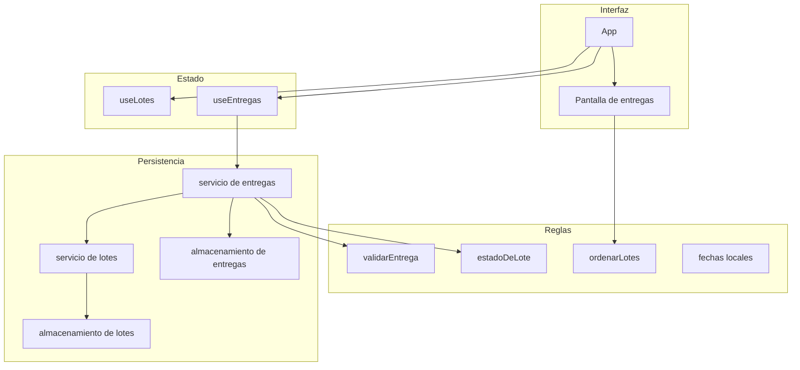

# Documento de diseño

## Overview

Esta etapa permite a Lucía anotar una entrega mientras la familia espera, y a Jorge revisar al cierre qué salió. La entrega descuenta cantidad de un lote que ya existe. No crea alimentos, no cambia el vencimiento y no guarda un padrón de familias.

Sigue siendo la misma SPA en JavaScript, React, Vite y Tailwind. El navegador guarda los lotes en `manos-a-la-obra.lotes` y las entregas en una clave nueva. Otro dispositivo no ve ninguno de los dos.

El estado de vencimiento se sigue calculando al mostrar el lote. Una entrega vencida no se puede confirmar.

### Decisiones

- La pantalla de entregas muestra el formulario y el historial juntos. Después de guardar, Lucía ve la fila nueva sin cambiar de sección. Así el recorrido cabe en menos de un minuto.
- Los lotes con cantidad mayor que cero se listan para elegir, vencidos incluidos, ordenados por vencimiento ascendente. El vencido se ve y no se puede elegir. El mensaje explica que no se entrega alimento vencido.
- Si la cantidad entregada iguala la disponible, el lote sale del stock. Su nombre, unidad y fechas quedan copiados en la entrega para el historial y para poder anularla.
- Si la cantidad es menor, el lote conserva el id, la unidad y las fechas. Solo cambia la cantidad.
- Anular suma la cantidad al lote del mismo id cuando sigue en el stock. Si ese lote ya no está, se vuelve a crear con el id, la unidad y las fechas guardadas en la entrega.
- No hay entregas de demostración. Si la clave no existe, el historial está vacío y no se escribe una semilla.
- La familia se recorta, admite hasta 80 caracteres y se guarda tal como la escribió Lucía.
- La fecha vacía es el día local. Una fecha indicada debe ser un día real. Puede ser anterior a hoy, para anotar una entrega olvidada. Una fecha futura se rechaza.
- Las sumas y restas de cantidad se redondean a tres decimales. Así un resto de `0.30000000004` no deja el lote en el stock ni lo vuelve negativo.
- Si al anular el lote existe pero su unidad ya no coincide con la entrega, la anulación se rechaza y no se escribe nada.
- Registrar y anular escriben las dos claves. Si la segunda escritura falla, se restaura la primera. Un fallo no deja el stock descontado sin historial, ni el historial sin el descuento.
- La navegación sigue en el estado de React. Se agrega el destino Entregas. Stock, Vencimientos y Registrar conservan su nombre y su comportamiento.

Si alguna de estas reglas no coincide con lo esperado, se puede volver a los requisitos antes de armar el plan.

## Architecture



`App` sigue eligiendo la vista. La pantalla de entregas no lee `localStorage`. Pide los lotes al hook que ya existe y las entregas al hook nuevo.

El servicio de entregas es el único que modifica las dos listas en una misma acción. Reutiliza la validación de fechas, el cálculo de vencimiento y el orden de lotes. No reemplaza el servicio de lotes: las donaciones se siguen creando, corrigiendo y borrando por ese camino.

### Arranque y escritura

1. Al abrir Entregas, los lotes salen de la clave actual. Si la clave de entregas no está, el historial queda vacío y no se escribe.
2. Si la clave de entregas existe, se muestra ese arreglo, aunque esté vacío.
3. Si la lectura de entregas falla, se muestra el aviso y no se toca la clave de lotes ni la de entregas.
4. Al confirmar una entrega válida, el servicio calcula las dos listas nuevas, escribe entregas y después lotes. Si la escritura de lotes falla, restaura las entregas anteriores y devuelve el fallo.
5. La pantalla reemplaza las dos listas en memoria solo cuando las dos escrituras terminaron bien.

## Components and Interfaces

Se agregan archivos en las carpetas que ya existen. No hay carpetas nuevas.

### Pantalla

`EntregasPage` junta el formulario y el historial.

| Zona | Responsabilidad | Requisitos |
| --- | --- | --- |
| Formulario | Elige un lote disponible, pide familia, cantidad y fecha, y confirma. | 1.1, 1.2, 1.3, 1.4, 1.5, 1.6, 5.1, 5.2 |
| Historial | Lista las entregas y ofrece anular cada una. | 2.1, 2.2, 2.3, 2.4, 3.1 |
| Navegación | Destino Entregas, con texto y estado activo. | 5.3 |

En la tablet, el formulario queda arriba y el historial abajo. Los lotes para elegir se muestran como opciones grandes, no como un selector diminuto. Cada opción muestra nombre, cantidad, unidad, vencimiento y la etiqueta de estado que ya existe.

### Componentes

- `FormularioEntrega`. Familia, cantidad y fecha. La fecha puede quedar vacía. Los lotes vencidos aparecen deshabilitados, con el texto de que no se entrega alimento vencido. El mensaje de cada dato inválido queda junto al campo.
- `HistorialEntregas`. Fecha, familia, alimento, cantidad, unidad y vencimiento del lote. Orden: fecha de entrega descendente y, en la misma fecha, el orden de registro. El estado vacío explica cómo registrar la primera entrega.
- `Navegacion`. Se agrega el destino `entregas`, con ícono y la etiqueta «Entregas». El destino activo se marca con el verde hoja y con texto.
- `DialogoConfirmar`. Se reutiliza para la anulación. Confirmar ejecuta la anulación. Cancelar cierra el diálogo.
- `AvisoError` y `EtiquetaEstado`. Se reutilizan sin cambiar su contrato.

### Hooks

`useLotes()` sigue cargando, creando, corrigiendo y eliminando donaciones. Se agrega `reemplazarLotes(lotes)` para que una entrega confirmada actualice el stock en memoria sin volver a sembrar datos.

`useEntregas()` devuelve:

- `entregas`: lista guardada.
- `error`: `null`, `"lectura"` o `"escritura"`.
- `registrar(entrada)`.
- `anular(id)`.

`registrar` y `anular` devuelven los errores de validación sin escribir cuando la entrada no es válida. Si la operación termina bien, devuelven la lista nueva de entregas y la lista nueva de lotes. `App` pasa esa lista de lotes a `reemplazarLotes`.

### Servicio de entregas

- `obtenerEntregas()` lee la clave. La ausencia es un historial vacío. Un valor que no es una lista de entregas es un fallo de lectura y no escribe.
- `registrarEntrega(entrada)` toma el lote, valida, arma la entrega y las dos listas, y persiste las dos. Si el lote no existe, está vencido o la cantidad no entra, no escribe.
- `anularEntrega(id)` quita esa entrega. Si el lote sigue y la unidad coincide, suma la cantidad. Si el lote no está, lo recrea con los datos copiados en la entrega. Si el id no existe, no escribe.

El id de la entrega sale de `crypto.randomUUID()`. La `secuencia` es un entero mayor que el máximo ya guardado, para ordenar las de la misma fecha.

### Almacenamiento

La clave nueva es `manos-a-la-obra.entregas`.

El acceso queda en `src/services/almacenamientoEntregas.js`, con la misma forma de resultado que el de lotes: ausencia, ok o fallo de lectura; ok o fallo de escritura. El módulo de lotes no cambia de clave. Así las donaciones siguen cubiertas por sus pruebas actuales.

### Reglas puras

`validarEntrega(entrada, lote, hoy)` vive en `src/utils/validarEntrega.js` y reutiliza `esFechaReal` y `estadoDeLote`.

- La familia, ya recortada, tiene entre 1 y 80 caracteres.
- La cantidad es finita, mayor que cero y menor o igual que la disponible del lote.
- Con unidad `unidades`, la cantidad es entera. Con `kilogramos` o `litros`, tiene hasta tres decimales.
- La fecha vacía es válida. Si viene, es un día real y no es posterior a `hoy`.
- El lote existe, tiene cantidad mayor que cero y su estado no es `vencido`.

`aplicarEntrega(lotes, entregas, entrada)` y `aplicarAnulacion(lotes, entregas, id)` devuelven las dos listas siguientes sin tocar el almacenamiento. Las pruebas de stock negativo, lote agotado y lote recreado corren sobre estas funciones.

## Data Models

La entrega guarda una copia de lo necesario para el historial y para restaurar el lote. El vencimiento de la entrega no se recalcula: es el que tenía el lote al momento de entregarlo.

```json
{
  "id": "6f1c2a40-9c0e-4d1a-8b77-2a1d0e5c9f10",
  "loteId": "550e8400-e29b-41d4-a716-446655440000",
  "familia": "Familia Gómez",
  "cantidad": 1.5,
  "unidad": "kilogramos",
  "nombreAlimento": "Arroz",
  "fechaRecepcion": "2026-11-01",
  "fechaVencimiento": "2026-11-08",
  "fechaEntrega": "2026-11-03",
  "secuencia": 4
}
```

| Campo | Regla |
| --- | --- |
| `id` | Identificador de la entrega. No lo edita el formulario. |
| `loteId` | Id del lote descontado. Sirve para sumar o para recrear ese lote. |
| `familia` | Obligatoria después de recortar. Entre 1 y 80 caracteres. |
| `cantidad` | La cantidad que salió, con las mismas reglas de decimales que el lote. |
| `unidad` | Copia de la unidad del lote. |
| `nombreAlimento` | Copia del nombre del lote. |
| `fechaRecepcion` | Copia de la recepción del lote. Hace falta para recrearlo. |
| `fechaVencimiento` | Copia del vencimiento del lote. |
| `fechaEntrega` | `YYYY-MM-DD`. Si el formulario la deja vacía, el servicio pone el día local. |
| `secuencia` | Entero creciente. Ordena las entregas de una misma fecha. |

El lote no gana campos nuevos. Una entrega parcial solo cambia `cantidad`. Una entrega total lo quita de la lista.

## Error Handling

| Situación | Qué ve Lucía o Jorge | Qué hace el sistema |
| --- | --- | --- |
| Familia vacía, cantidad inválida o mayor que el stock | Mensaje en español junto al campo | No escribe |
| Lote vencido | La opción deshabilitada y el texto de que no se entrega alimento vencido | No escribe |
| Fecha futura o imposible | Mensaje junto a la fecha | No escribe |
| Anulación cancelada | El diálogo se cierra | Entrega y stock siguen igual |
| Entrega a anular que ya no está | Mensaje breve de que esa entrega ya no está | No escribe |
| Lote existente con otra unidad | Mensaje de que ese lote cambió y no se puede devolver la cantidad | No escribe |
| Clave de entregas ausente | Historial vacío | No escribe una semilla |
| Lectura de entregas imposible | «No se pudieron leer las entregas guardadas.» | No modifica lotes ni entregas |
| Escritura imposible | «No se pudo guardar el cambio. El stock y las entregas siguen como estaban.» | Restaura la clave que haya alcanzado a cambiar y deja las dos listas anteriores en pantalla |

Leer o escribir `localStorage` puede lanzar `SecurityError` o `QuotaExceededError`. Las dos claves quedan dentro de `try/catch`, igual que las donaciones.

Un JSON de entregas que no es un arreglo, o una entrega sin los campos copiados del lote, se trata como fallo de lectura de todo el historial. No se descartan filas sueltas.

## Testing Strategy

Las pruebas nuevas usan Vitest, en Node para las reglas y el servicio, y `jsdom` solo para los componentes. Van junto al archivo que prueban.

### Reglas y stock

- Rechazar familia vacía, cantidad cero, negativa o mayor que la disponible, decimales en unidades y más de tres decimales en kilogramos o litros.
- Rechazar un lote vencido y aceptar uno que vence hoy.
- Completar la fecha vacía con el día recibido por la prueba. Rechazar una fecha posterior a ese día.
- Descontar una entrega parcial y conservar id, unidad y fechas del lote.
- Quitar el lote del stock cuando la cantidad entregada lo deja en cero, y conservar nombre, unidad y vencimiento en la entrega.
- Impedir que la cantidad del lote quede negativa, también con restas de tres decimales.
- Anular contra un lote existente suma la cantidad. Anular contra un lote ausente lo recrea con el id y las fechas copiadas. Cancelar no llama a la anulación.
- Ordenar el historial por fecha descendente y, en la misma fecha, por `secuencia` ascendente.

### Persistencia

- Si la clave de entregas no existe, devolver una lista vacía y comprobar que no se escribió una semilla.
- Si el JSON de entregas es ilegible, devolver fallo de lectura y comprobar que la clave de lotes no cambió.
- Si la segunda escritura falla, restaurar la primera clave y comprobar que lotes y entregas quedan como antes de la operación.
- Después de registrar y anular, una lectura nueva devuelve el mismo stock y el mismo historial.

### Interfaz

Un grupo corto de pruebas de componentes cubre el mensaje junto al campo inválido, el lote vencido deshabilitado con su texto, el historial vacío y el diálogo que no anula al cancelar.

La métrica de un minuto no se mide con un temporizador automático: el formulario y el historial están en la misma pantalla para que el recorrido sea corto. Las pruebas automáticas cubren el descuento exacto, el orden por vencimiento, los datos del historial y el rechazo del lote vencido.
