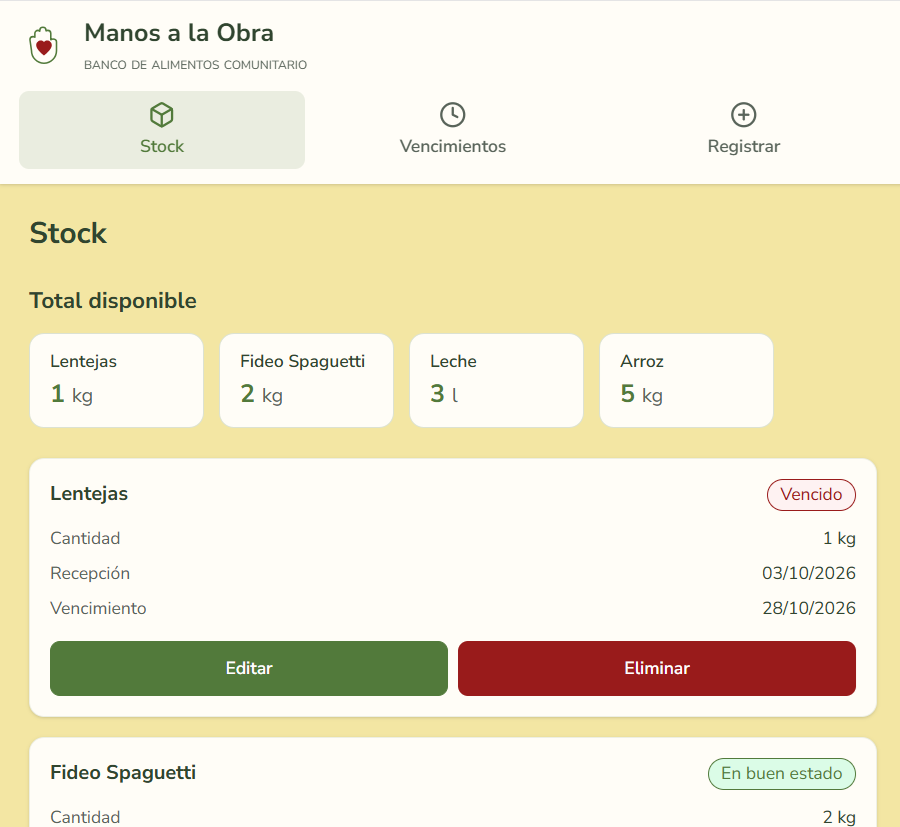

# Manos a la Obra

Banco de alimentos comunitario. Esta etapa permite a los voluntarios registrar donaciones, consultar el stock, ver qué alimentos están próximos a vencer o ya vencieron y registrar las entregas.



Los datos se guardan en el navegador. No hay cuentas ni sincronización entre dispositivos. La gestión de familias, las entregas y la distribución quedan fuera de esta etapa.

## Uso local

```powershell
npm install
npm run dev
```

La aplicación queda en `http://localhost:5173`.

```powershell
npm test
npm run build
```

`npm run build` genera la carpeta `dist`. Esa carpeta es la que se publica en Netlify.
